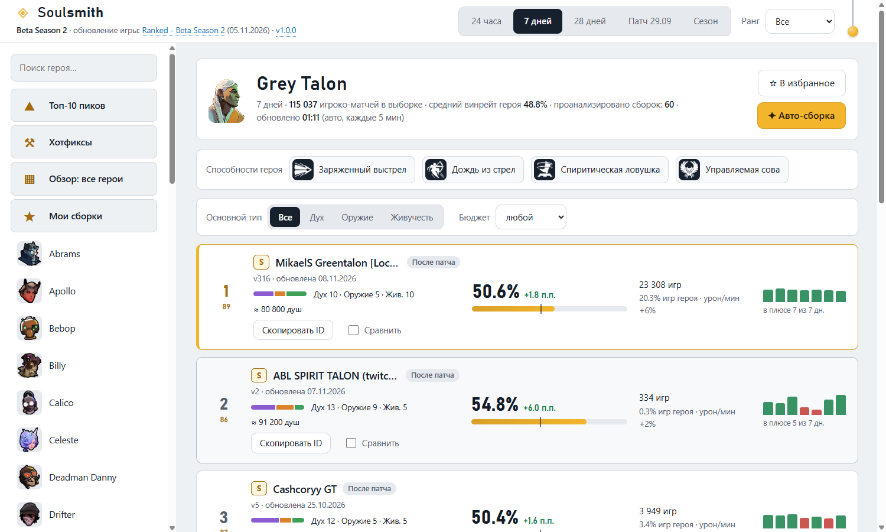
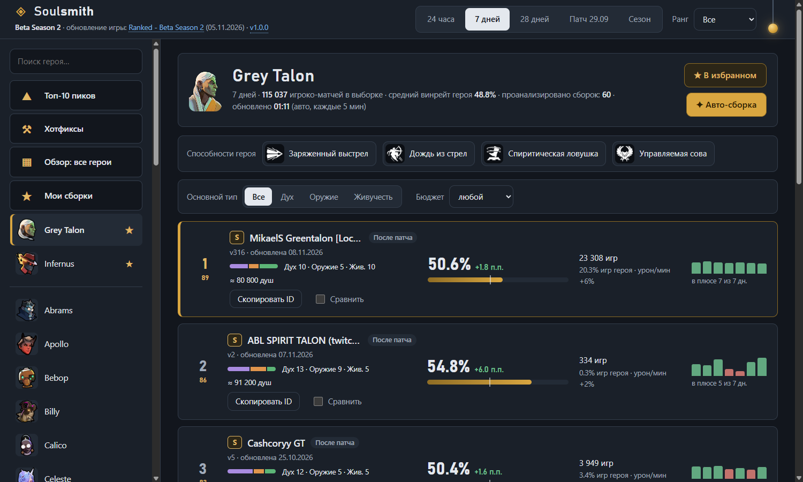
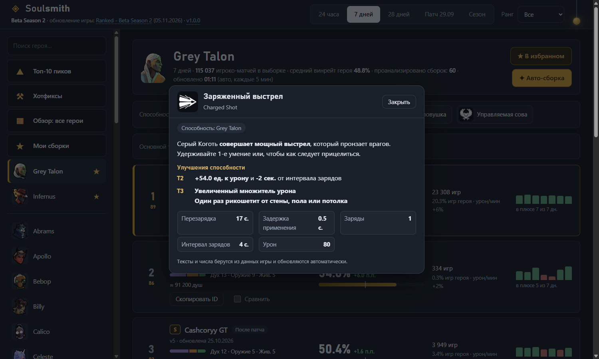
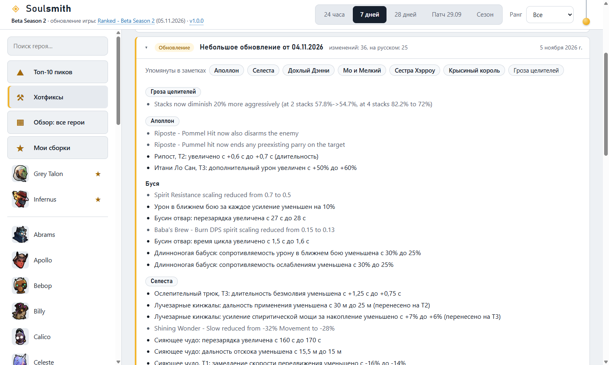
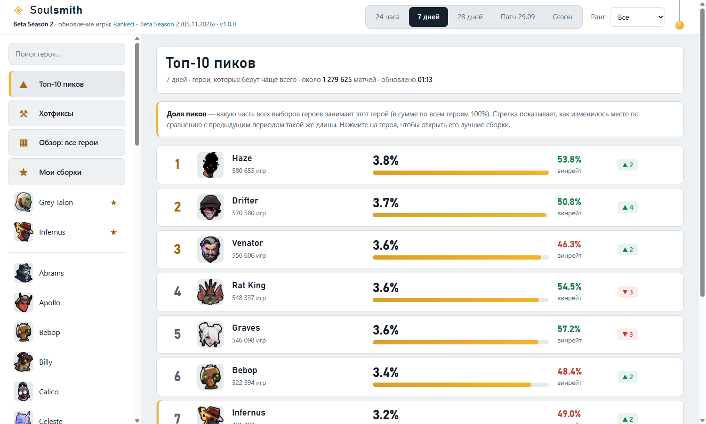
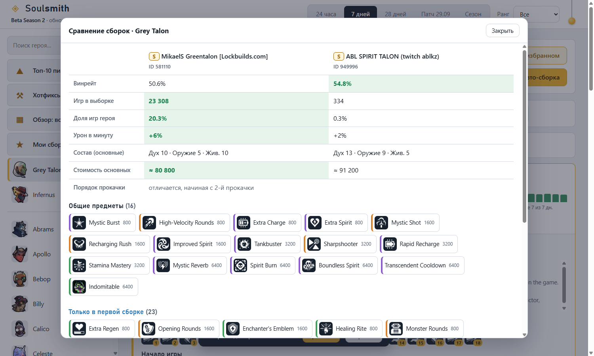

# Soulsmith

Приложение для Windows, которое помогает собрать билд в Deadlock. Оно берёт свежую статистику матчей и показывает, какие сборки работают прямо сейчас, а ещё объясняет предметы и способности и разбирает хотфиксы на русском.



## Что умеет

* **Топ сборок героя** за 24 часа, 7 и 28 дней, с последнего крупного патча или с начала сезона. Рейтинг считается по винрейту, популярности и урону в минуту, случайные «везунчики» отсеиваются.
* **Топ-10 пиков**: кого берут чаще всего и как изменилось место по сравнению с прошлым периодом.
* **Описания по клику**: любой предмет и любая способность открываются с описанием, характеристиками и улучшениями. Тексты берутся из игровых данных на русском языке.
* **Хотфиксы и обновления**: только официальные заметки разработчиков, с переводом на русский и переключателем на оригинал.
* **Сравнение двух сборок**: общие предметы, отличия, стоимость, порядок прокачки.
* **Фильтры** по основному типу предметов (дух, оружие, живучесть) и по бюджету.
* **Метки** «Новая», «Изменена» и «После патча».
* **Избранные герои** всегда в начале списка.
* **Мои сборки**: свои сборки, копии из топа и авто-сборка из лучших вариантов.
* **Копирование ID** сборки (только цифры, для поиска в игре) и всей сборки обычным текстом.
* **Светлая и тёмная тема**. Переключатель это шнурок в углу шапки, новая тема расходится кругом от узелка.
* **Обновление из приложения**: плашка «Есть доступное обновление, версия X» и кнопка «Обновить».











## Как запустить

Скачайте архив из раздела Releases, распакуйте и запустите `Soulsmith.exe`. Установка не нужна.

Из исходников нужен Node.js 18 или новее:

```
npm install
npm start
```

Только серверная часть в браузере: `npm run server`, затем адрес `http://localhost:5177`.

## Сборка exe

Двойной клик по `build-exe.bat` или команда:

```
npm run package
```

Готовое приложение появится в папке `release`.

## Антивирус и SmartScreen

Приложение не подписано сертификатом разработчика, поэтому при первом запуске скачанного архива Windows SmartScreen может написать «Неизвестный издатель». Это ожидаемо для любых неподписанных программ. Нажмите «Подробнее», затем «Выполнить в любом случае».

Некоторые антивирусы осторожнее относятся к программам на Electron, которые сами проверяют обновления. Если сомневаетесь:

* сверьте контрольную сумму архива с файлом `SHA256.txt` из релиза (`Get-FileHash архив.zip` в PowerShell);
* соберите приложение сами из исходников через `build-exe.bat`: код открыт, зависимостей мало;
* если антивирус всё же блокирует файл, добавьте папку приложения в исключения или отправьте файл вендору как ложное срабатывание.

Что приложение делает на компьютере: запускает локальный сервер на `127.0.0.1` (наружу он не слушает), читает открытые данные по сети, пишет только в `%APPDATA%\Soulsmith`. Установку обновления выполняет по кнопке, и ничего не скачивает и не запускает без неё.

## Карта проекта

### Запуск и окно

* `main.js`: точка входа. Решает, какой код запускать: встроенный или установленное обновление, если оно новее. Если обновление не стартовало, откатывается на встроенный код.
* `desktop.js`: окно Electron. Поднимает встроенный сервер на фиксированном порту 47831 (чтобы сохранялись настройки интерфейса), следит, чтобы запускался один экземпляр, спрашивает про несохранённые изменения при закрытии, перезапускает приложение после обновления.
* `build-exe.bat`: сборка exe для разработчика.
* `build/`: иконка приложения.

### Сервер

* `server.js`: локальный HTTP-сервер без зависимостей. Раздаёт интерфейс, отвечает на запросы `/api/...`, ходит во внешние источники с очередью, повторами, таймаутами и кэшем. Считает рейтинг сборок, топ пиков и периоды (в том числе «Патч» и «Сезон»).
* `describe.js`: описания предметов и способностей, способности героя, список названий для поиска упоминаний, глоссарий английских и русских названий.
* `news.js`: официальные заметки разработчиков из анонсов Valve в Steam. Разбирает разметку, группирует правки по героям и предметам, находит упоминания.
* `translate.js`: перевод строк хотфиксов на русский (подробнее ниже).
* `autobuild.js`: авто-сборка. Собирает билд из статистики лучших сборок и покупок и проверяет его на логичность.
* `mybuilds.js`: хранение «Моих сборок» на диске и проверка входных данных.
* `updater.js`: проверка релизов, скачивание и установка обновления.

### Интерфейс (`public/`)

* `index.html`: каркас страницы и ранняя установка темы, чтобы страница не мигала.
* `app.js`: основной экран. Навигация, страница героя, топ пиков, обзор, хотфиксы, окно описаний, сравнение, фильтры, избранные герои, плашка обновлений.
* `mybuilds.js`: страница «Мои сборки» и редактор.
* `theme.js`: переключатель темы с анимацией.
* `style.css`: все стили, светлая и тёмная палитры через переменные.

### Запросы интерфейса к серверу

* `GET /api/heroes`, `GET /api/meta`: список героев, текущий сезон, патч и последнее обновление игры.
* `GET /api/hero/:id`, `GET /api/build/:heroId/:buildId`: топ сборок героя и состав сборки.
* `GET /api/picks`, `GET /api/overview`: топ-10 пиков и обзор по всем героям.
* `GET /api/item/:id`: описание предмета или способности.
* `GET /api/hotfixes`: официальные заметки с переводом.
* `GET /api/auto/:heroId`, `GET /api/catalog/:heroId`: авто-сборка и каталог предметов для редактора.
* `GET`, `POST`, `PUT`, `DELETE /api/my`: «Мои сборки».
* `GET /api/update`, `POST /api/update/install`, `POST /api/update/restart`: обновление приложения.

## Откуда данные

* Статистика матчей, сборки, игровые справочники (герои, предметы, способности, описания) идут из открытого API deadlock-api.com.
* Хотфиксы идут напрямую из официальных анонсов разработчиков в Steam. Пресса и сторонние ленты отбрасываются.

Справочники обновляются каждые полчаса и сразу же, как только в официальном канале появляется новая заметка. Поэтому новые герои, способности и предметы, а также правки после патчей появляются без обновления самого приложения.

## Как переводятся хотфиксы

Бесплатные онлайн-переводчики дают нестабильное качество и ломают игровые термины, поэтому перевод сделан по правилам и работает без интернета:

* Названия героев, способностей и предметов берутся из русской версии игры, поэтому совпадают с тем, что игрок видит в клиенте.
* Названия характеристик (перезарядка, дальность, урон и так далее) берутся из игровых данных и дополнены словарём в `translate.js`.
* Переводятся формульные строки патчноутов вида «что-то увеличено или уменьшено с A до B». Они составляют около половины всех правок и именно они важнее всего для планирования билда.
* Свободные фразы («теперь также делает то-то», «исправлена ошибка…») надёжно по правилам не перевести, поэтому они показываются на английском. Чем ближе строка к формуле, тем лучше результат. У переведённых строк при наведении виден оригинал.

Что будет с новыми героями, способностями и предметами: их русские названия подтягиваются автоматически, как только они появятся в игровых данных вместе с локализацией. Если русского названия ещё нет, показывается английское. Новые слова в формулах, которых нет ни в игровых данных, ни в словаре, оставляют строку на английском. Их добавляют в словарь `MANUAL` в `translate.js`.

## Как выходят обновления

Приложение раз в несколько часов читает последний релиз репозитория. Если версия выше установленной, наверху появляется плашка. По кнопке «Обновить» скачивается код приложения, проверяется и ставится рядом с основной программой, после чего нужно нажать «Перезапустить».

Чтобы выпустить обновление:

1. Поднять `version` в `package.json`.
2. Закоммитить и запушить.
3. Создать релиз с тегом `vX.Y.Z` (версия в теге должна совпадать с `package.json`) и кратким описанием, оно покажется в плашке.
4. Для новой версии самого Electron собрать exe заново и приложить его к релизу как архив.

Для проверки обновлений репозиторий должен быть публичным, иначе релизы не видны без ключа. Репозиторий задаётся числовым идентификатором `updateRepoId` в `package.json`, поэтому ни имени владельца, ни адресов в приложении нет.

## Где лежат данные

* Сохранённые сборки и скачанные обновления: `%APPDATA%\Soulsmith`.
* Настройки интерфейса (тема, избранные герои, язык хотфиксов): внутри самого приложения.

## Переменные для разработки

* `PORT`: порт серверной части при запуске `npm run server`.
* `SOULSMITH_DATA_DIR`: другая папка данных.
* `SOULSMITH_UPDATE_API`, `SOULSMITH_REPO_ID`, `SOULSMITH_FORCE_VERSION`: проверка обновлений на тестовом сервере.
